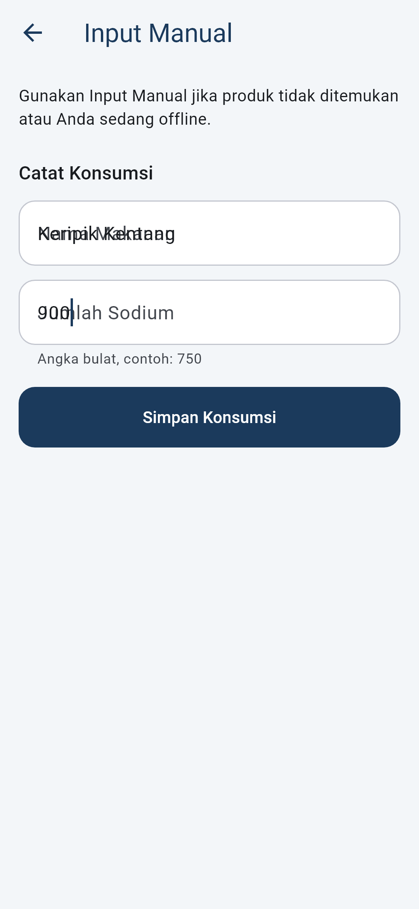
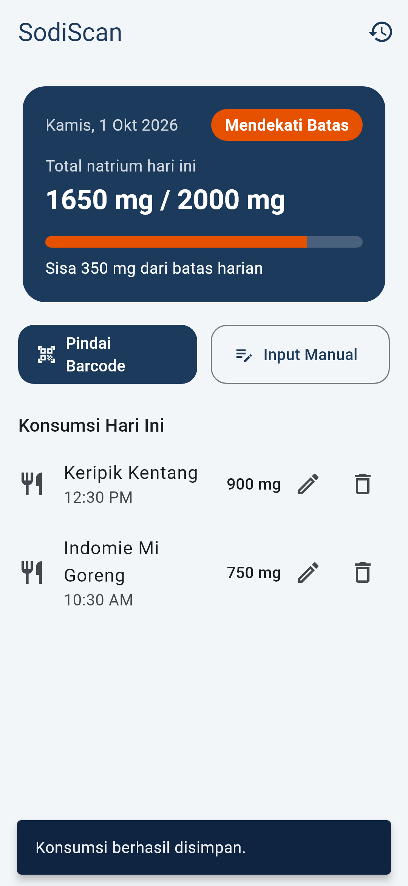
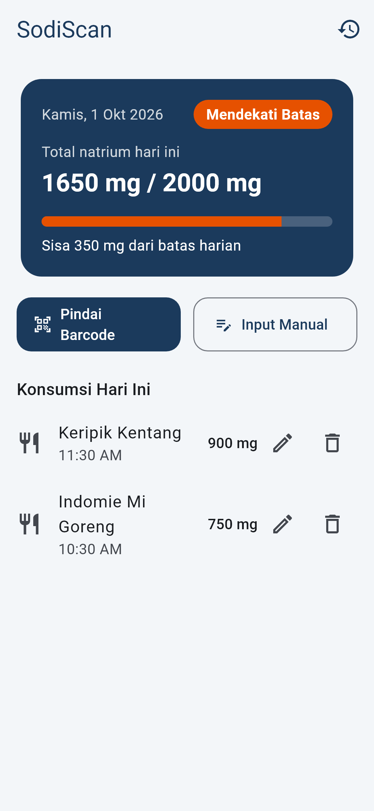
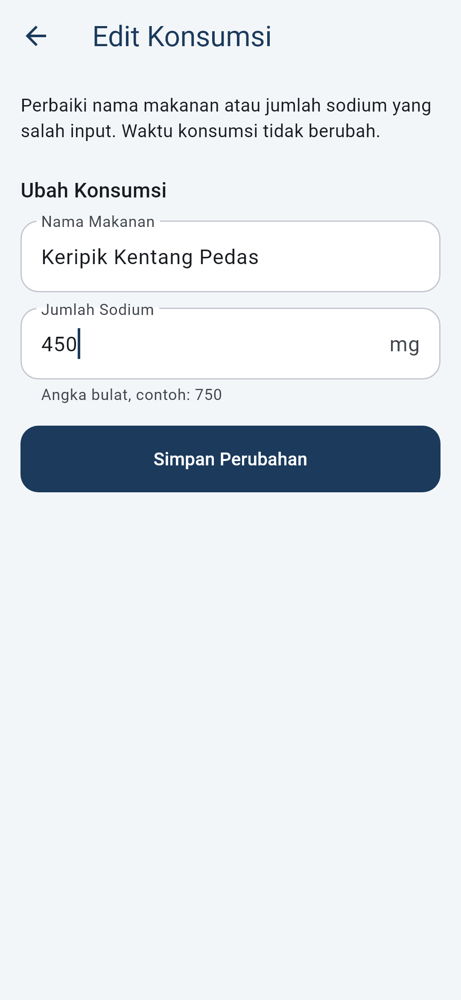
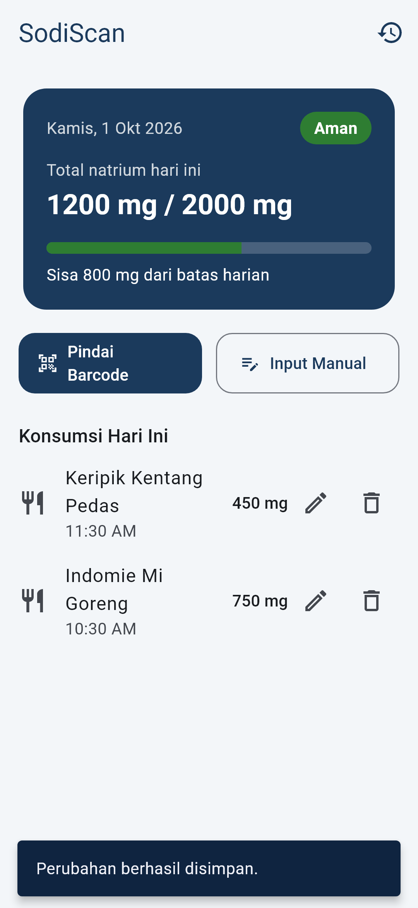
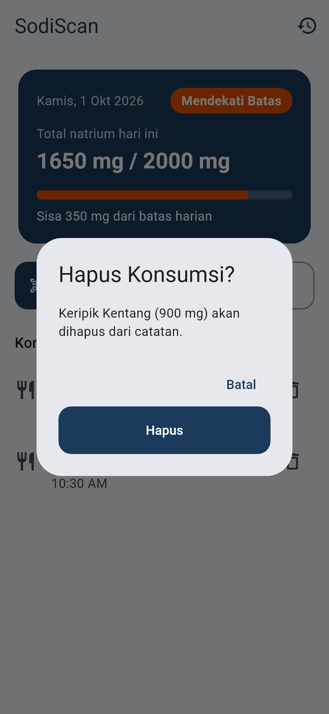
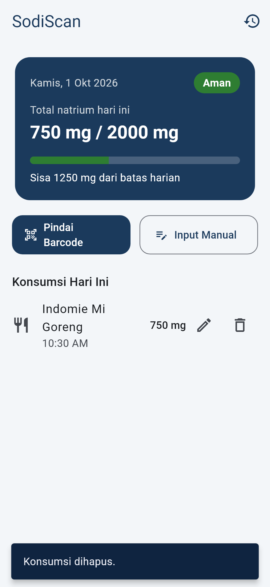
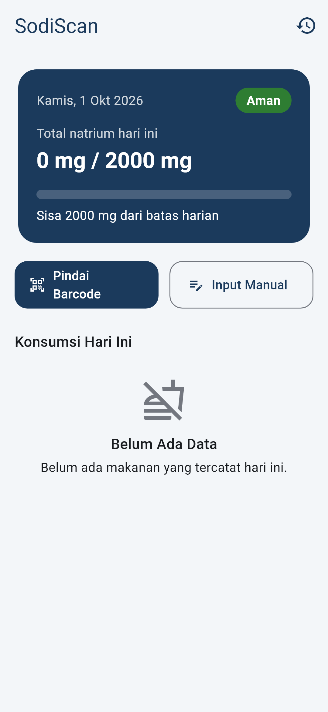

# Pertemuan 5 — Local Data & Persistence

Fitur vertikal yang dikerjakan: **Catatan Konsumsi Natrium** (FE → Local Storage).
Pengguna dapat menambah, melihat, mengubah, dan menghapus catatan konsumsi. Semua data disimpan di perangkat menggunakan **Hive** dan tetap tersedia setelah aplikasi ditutup lalu dibuka kembali.

## Ringkasan untuk Reviewer

| Kriteria tugas | Implementasi | Lokasi kode |
|---|---|---|
| Local Data | Hive box `consumptions` dibuka saat aplikasi start | [lib/main.dart](../lib/main.dart), [consumption_local_data_source.dart](../lib/data/datasources/local/consumption_local_data_source.dart) |
| Data Model | Entity `FoodConsumption` (domain) dan `FoodConsumptionModel` (`toMap` / `fromMap` untuk Hive) | [food_consumption.dart](../lib/domain/entities/food_consumption.dart), [food_consumption_model.dart](../lib/data/models/food_consumption_model.dart) |
| **C**reate | Input Manual / Cari Produk → `RecordConsumption` → `saveConsumption` | [record_consumption.dart](../lib/domain/usecases/record_consumption.dart) |
| **R**ead | Beranda (hari ini) dan Riwayat (semua tanggal) → `getConsumptionsByDate`, `getAllConsumptions` | [get_daily_summary.dart](../lib/domain/usecases/get_daily_summary.dart), [get_consumption_history.dart](../lib/domain/usecases/get_consumption_history.dart) |
| **U**pdate | Ikon pensil di Beranda → form Edit Konsumsi → `UpdateConsumption` → `updateConsumption` | [update_consumption.dart](../lib/domain/usecases/update_consumption.dart) |
| **D**elete | Ikon tempat sampah + dialog konfirmasi → `DeleteConsumption` → `deleteConsumption` | [delete_consumption.dart](../lib/domain/usecases/delete_consumption.dart) |
| Persistence Test | Box Hive ditutup (`Hive.close()`) lalu dibuka lagi, data Create/Update/Delete tetap sesuai | [consumption_persistence_test.dart](../test/data/consumption_persistence_test.dart) |

Implementasi repository yang menghubungkan domain dengan Hive ada di [consumption_repository_impl.dart](../lib/data/repositories/consumption_repository_impl.dart).

## Alur Data

```text
UI (HomeScreen / AddConsumptionScreen / HistoryScreen)
  └─ AddConsumptionNotifier / HistoryNotifier        (state management, provider)
       └─ Use case: Record / Update / Delete / GetDailySummary / GetConsumptionHistory
            └─ ConsumptionRepository (abstract, domain)
                 └─ ConsumptionRepositoryImpl (data)
                      └─ ConsumptionLocalDataSource ── Hive Box<Map> "consumptions" (disk)
```

## Data Model yang Disimpan

Setiap catatan disimpan sebagai `Map` dengan key = `id`:

| Field | Tipe | Keterangan |
|---|---|---|
| `id` | String | ID unik (timestamp mikrodetik saat dibuat) |
| `barcode` | String? | Barcode produk jika dari Cari Produk |
| `productName` | String | Nama makanan |
| `sodiumMg` | double | Jumlah natrium (mg) |
| `source` | String | `scan` atau `manual` |
| `consumedAt` | String (ISO 8601) | Waktu konsumsi |

Aturan validasi (dipakai Create dan Update): nama tidak boleh kosong, sodium > 0 dan ≤ 10000 mg. Saat Update, `id`, `source`, dan `consumedAt` tidak berubah.

## Bukti CRUD

| Operasi | Screenshot |
|---|---|
| Create — isi form |  |
| Create — hasil di Beranda |  |
| Read — Beranda |  |
| Read — Riwayat |  |
| Update — form edit |  |
| Update — hasil |  |
| Delete — konfirmasi |  |
| Delete — hasil |  |
| Data kosong |  |

Screenshot dibuat otomatis dengan `flutter test --update-goldens test_screenshots/capture_p5_crud_test.dart`.

## Bukti Persistence

Test [consumption_persistence_test.dart](../test/data/consumption_persistence_test.dart) memakai Hive sungguhan di folder sementara:

1. Buka box → lakukan Create / Update / Delete.
2. `Hive.close()` (sama seperti aplikasi ditutup).
3. Buka box lagi dengan repository baru (sama seperti aplikasi dijalankan kembali).
4. Periksa data yang terbaca sesuai dengan operasi sebelumnya.

Output test: [test-output.txt](screenshots/pertemuan5/test-output.txt)

```bash
flutter test test/data/consumption_persistence_test.dart
```

### Demo manual (aplikasi dijalankan kembali)

1. `flutter run` di emulator/HP.
2. Tambah konsumsi lewat **Input Manual**, ubah salah satu dengan ikon pensil, hapus satu dengan ikon tempat sampah.
3. Tutup aplikasi sepenuhnya (swipe dari recent apps), lalu buka lagi.
4. Data di Beranda dan Riwayat tetap sama seperti sebelum ditutup.
