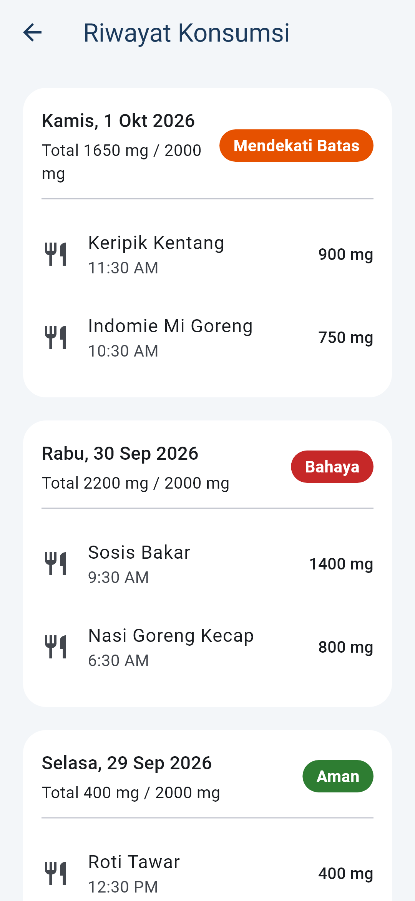
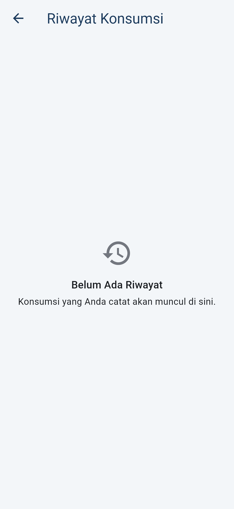
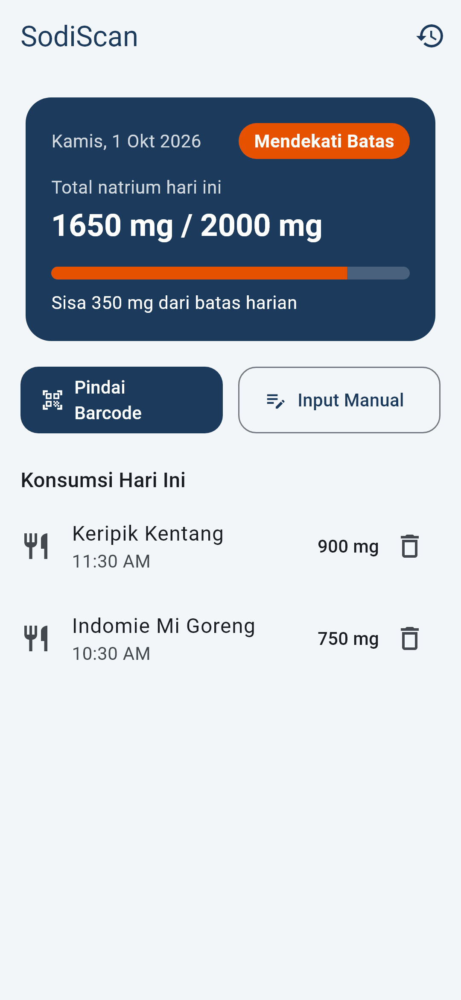
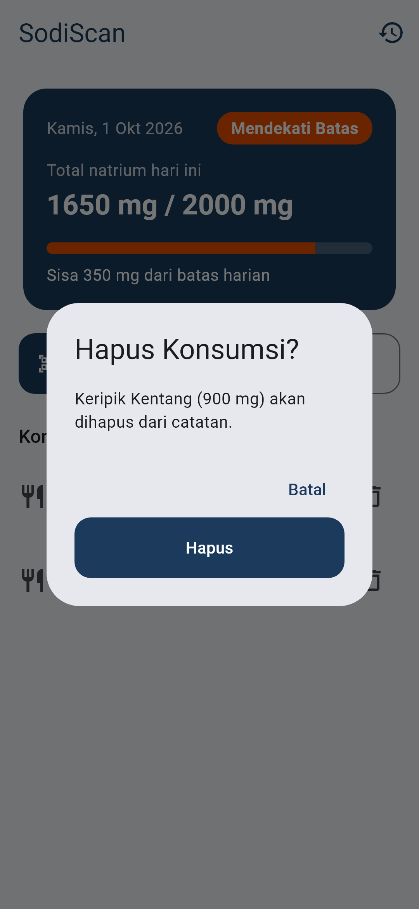
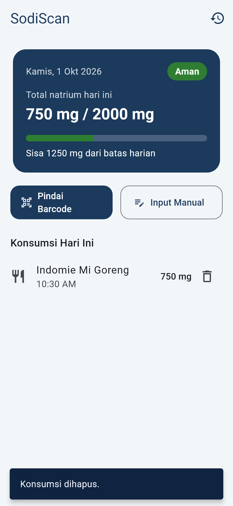
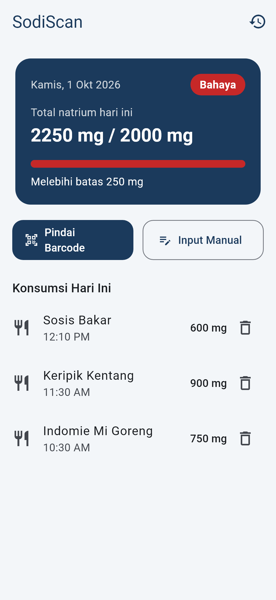
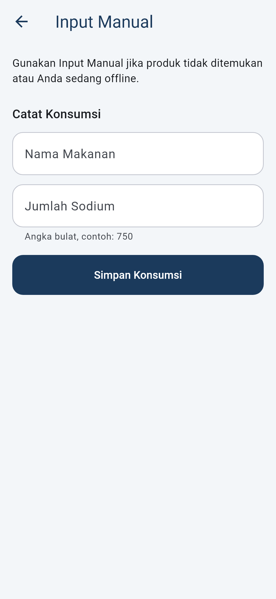

# Pertemuan 5 — MVP Version 1 (Iteratif dengan AI Agent)

Dokumen ini mencatat proses pembangunan **MVP Version 1** SodiScan secara fitur demi fitur dengan bantuan AI Agent (Claude Code). Setiap fitur melewati siklus **Brief → Plan → Build → Verify → Commit**.

> Prinsip: AI Agent **tidak** diminta membuat aplikasi sekaligus. AI Agent dipakai untuk satu fitur pada satu waktu, lalu hasilnya direview, diuji, dan di-commit sebelum lanjut ke fitur berikutnya.

## Ringkasan

| Item | Status |
|---|---|
| Fitur inti yang dikerjakan | 1. Riwayat Konsumsi · 2. Hapus Konsumsi · 3. Beranda (dashboard) |
| Branch | `main` |
| Commit fitur | _(isi hash commit setelah commit di VS Code)_ |
| Unit & widget test | 63 test, semua lulus (sebelumnya 44) |
| `flutter analyze` | No issues found |
| Build | `flutter build web` berhasil, aplikasi terbuka di browser |
| Bukti | [test-output.txt](screenshots/pertemuan5/test-output.txt), screenshot di [screenshots/pertemuan5](screenshots/pertemuan5) |

### Kondisi awal (sebelum Pertemuan 5)

Fitur yang sudah ada dari pertemuan sebelumnya: Tambah Konsumsi manual (total harian + status risiko) dan Cari Produk via barcode (Open Food Facts). Yang belum ada dari `Architecture.md`: **Riwayat Konsumsi** (use case `GetConsumptionHistory` belum dibuat) dan cara memperbaiki data yang salah input.

### Mengapa 2 fitur ini?

1. **Riwayat Konsumsi**: termasuk kriteria berhasil di README ("Data riwayat konsumsi tetap tersimpan dan dapat ditampilkan kembali") dan use case wajib di `Architecture.md`. Tanpa riwayat, pengguna hanya bisa melihat hari ini.
2. **Hapus Konsumsi**: tanpa fitur ini, satu salah input (misalnya 7500 mg, padahal maksudnya 750 mg) membuat total dan status risiko hari itu salah permanen. Indikator risiko adalah inti aplikasi, jadi datanya harus bisa dikoreksi.

Fitur Barcode Scanner kamera (`mobile_scanner`) **sengaja ditunda** ke iterasi berikutnya karena butuh perangkat Android/iOS fisik untuk verifikasi. Pencarian produk lewat input kode barcode sudah tersedia.

---

## Fitur 1 — Riwayat Konsumsi

### Brief

> Sebagai pengguna, saya ingin melihat riwayat konsumsi per tanggal beserta total natrium dan status risikonya, agar saya tahu pola konsumsi saya beberapa hari terakhir, termasuk saat offline.

**Acceptance criteria**

| ID | Kriteria |
|---|---|
| R1 | Dari Beranda ada tombol **Riwayat** yang membuka halaman *Riwayat Konsumsi*. |
| R2 | Konsumsi dikelompokkan per tanggal, tanggal terbaru di atas. |
| R3 | Setiap tanggal menampilkan total natrium, batas 2000 mg, dan badge status (Aman / Mendekati Batas / Bahaya) sesuai aturan domain. |
| R4 | Di dalam satu tanggal, konsumsi diurutkan dari yang terbaru. |
| R5 | Data dibaca dari Hive (lokal), tidak memanggil API. |
| R6 | Ada state loading, kosong ("Belum Ada Riwayat"), dan error dengan tombol "Coba Lagi". |
| R7 | Tanggal tampil dalam Bahasa Indonesia, contoh `Kamis, 1 Okt 2026`. |

### Plan

| Layer | Perubahan |
|---|---|
| Domain | `ConsumptionRepository.getAllConsumptions()`; use case baru `GetConsumptionHistory`; factory `DailyNutrition.fromConsumptions()` supaya aturan total + status risiko ada di satu tempat (dipakai juga oleh `GetDailySummary`). |
| Data | `ConsumptionRepositoryImpl.getAllConsumptions()` membaca semua data dari Hive, error dibungkus `StorageFailure`. |
| Presentation | `HistoryState`, `HistoryNotifier`, `HistoryScreen`, tombol `openHistoryButton` di AppBar, util `formatDateId`. |
| Test | Unit test use case, test repository dengan Hive sungguhan, test notifier, widget test, test format tanggal. |

### Build

File baru: `lib/domain/usecases/get_consumption_history.dart`, `lib/core/utils/date_format.dart`, `lib/presentation/providers/history_state.dart`, `lib/presentation/providers/history_notifier.dart`, `lib/presentation/screens/history/history_screen.dart`.

File diubah: `daily_nutrition.dart`, `get_daily_summary.dart`, `consumption_repository.dart`, `consumption_repository_impl.dart`, `add_consumption_screen.dart`, `app.dart`.

### Verify

| AC | Bukti |
|---|---|
| R1, R3, R7 | `history_screen_test.dart` → *menampilkan konsumsi per tanggal beserta total dan status risiko* (navigasi lewat tombol, cek `Kamis, 1 Okt 2026`, `Total 750 mg / 2000 mg`, badge `Aman` dan `Mendekati Batas`). |
| R2, R3 | `get_consumption_history_test.dart` → *mengelompokkan konsumsi per tanggal dengan tanggal terbaru di atas* (total 1600 / 2100 / 500 → nearLimit / danger / safe). |
| R4 | `get_consumption_history_test.dart` → *konsumsi di dalam satu tanggal diurutkan dari yang terbaru*. |
| R5 | `consumption_repository_impl_test.dart` → *membaca seluruh riwayat konsumsi dari Hive* (Hive asli di folder sementara). |
| R6 | `history_notifier_test.dart` (success/empty/error) dan `history_screen_test.dart` → *empty state* dan *error dan bisa coba lagi*. |
| R7 | `date_format_test.dart`. |

Screenshot:

| Riwayat berisi data | Riwayat kosong |
|---|---|
|  |  |

### Commit

```text
<hash> feat(history): tambah halaman Riwayat Konsumsi per tanggal dengan total natrium dan status risiko
```

---

## Fitur 2 — Hapus Konsumsi

### Brief

> Sebagai pengguna, saya ingin menghapus catatan konsumsi yang salah input, agar total natrium dan status risiko hari ini kembali akurat.

**Acceptance criteria**

| ID | Kriteria |
|---|---|
| H1 | Setiap item konsumsi hari ini di Beranda punya tombol hapus (ikon tempat sampah). |
| H2 | Menekan tombol hapus memunculkan dialog konfirmasi **"Hapus Konsumsi?"** berisi nama produk dan jumlah natriumnya. |
| H3 | Menekan **Batal** tidak menghapus apa pun. |
| H4 | Menekan **Hapus** menghapus data dari Hive, lalu total dan status risiko dihitung ulang, dan muncul SnackBar "Konsumsi dihapus.". |
| H5 | Jika item terakhir dihapus, Beranda kembali ke empty state "Belum Ada Data". |
| H6 | Jika penghapusan gagal, muncul pesan "Konsumsi gagal dihapus. Silakan coba lagi." dan data tetap ada. |

### Plan

| Layer | Perubahan |
|---|---|
| Domain | `ConsumptionRepository.deleteConsumption(id)`; use case baru `DeleteConsumption`. |
| Data | `ConsumptionLocalDataSource.delete(id)` (Hive `box.delete`), `ConsumptionRepositoryImpl.deleteConsumption` → `StorageFailure` saat gagal. |
| Presentation | `AddConsumptionNotifier.delete(id)` (hapus lalu muat ulang ringkasan), `ConsumptionTile` menerima `onDelete` opsional, dialog konfirmasi + SnackBar di `AddConsumptionScreen`. |
| Test | Test repository (Hive), test notifier, 4 widget test (hapus, batal, item terakhir, gagal). |

Keputusan desain: tombol hapus hanya muncul di Beranda (konsumsi hari ini). Halaman Riwayat tetap read-only agar sederhana; `onDelete` dibuat opsional sehingga `ConsumptionTile` di Riwayat tidak berubah.

### Build

File baru: `lib/domain/usecases/delete_consumption.dart`.

File diubah: `consumption_repository.dart`, `consumption_local_data_source.dart`, `consumption_repository_impl.dart`, `add_consumption_notifier.dart`, `add_consumption_screen.dart`, `consumption_tile.dart`, `app.dart`, serta test yang membuat `AddConsumptionNotifier` (parameter `deleteConsumption` sekarang wajib).

### Verify

| AC | Bukti |
|---|---|
| H1, H2, H4 | `delete_consumption_test.dart` → *hapus konsumsi setelah konfirmasi lalu total dan status dihitung ulang* (1650 mg Mendekati Batas → 750 mg Aman, SnackBar tampil). |
| H3 | `delete_consumption_test.dart` → *menekan Batal tidak menghapus apa pun*. |
| H4 (Hive) | `consumption_repository_impl_test.dart` → *menghapus konsumsi dari Hive berdasarkan id*. |
| H5 | `delete_consumption_test.dart` → *menghapus konsumsi terakhir menampilkan empty state*. |
| H6 | `delete_consumption_test.dart` → *gagal menghapus menampilkan pesan error dan data tetap ada*; `add_consumption_notifier_test.dart` → *delete menghapus konsumsi lalu menghitung ulang ringkasan harian*. |

Screenshot:

| Sebelum hapus | Dialog konfirmasi | Sesudah hapus |
|---|---|---|
|  |  |  |

### Commit

```text
<hash> feat(consumption): tambah fitur hapus konsumsi dengan dialog konfirmasi dan hitung ulang total harian
```

---

## Fitur 3 — Beranda (Dashboard)

### Brief

> Saat membuka aplikasi, saya ingin langsung melihat ringkasan natrium hari ini dan memilih cara mencatat (Pindai Barcode atau Input Manual), bukan langsung masuk ke form.

Sebelumnya `home` aplikasi adalah `AddConsumptionScreen`, yaitu ringkasan dan form digabung dalam satu layar, sementara Cari Produk dan Riwayat hanya berupa ikon kecil. Halaman **Beranda** di `Architecture.md` belum ada.

**Acceptance criteria**

| ID | Kriteria |
|---|---|
| B1 | Aplikasi dibuka di **Beranda** (judul *SodiScan*). |
| B2 | Kartu ringkasan berisi tanggal hari ini, total natrium / 2000 mg, badge status, progress bar berwarna sesuai status, dan teks *Sisa X mg* atau *Melebihi batas X mg*. |
| B3 | Ada tombol **Pindai Barcode** (ke Cari Produk) dan **Input Manual** (ke form). |
| B4 | Daftar *Konsumsi Hari Ini* tampil di Beranda dan tetap bisa dihapus; kalau kosong, tampil "Belum Ada Data". |
| B5 | Setelah menyimpan di Input Manual, aplikasi kembali ke Beranda dan total ikut diperbarui. |
| B6 | Jika produk tidak ditemukan di Cari Produk, tombol **Input Manual** membuka form Input Manual. |
| B7 | Beranda hanya membaca data lokal, tidak memanggil API. |

### Plan

| Layer | Perubahan |
|---|---|
| Presentation | `HomeScreen` baru (ringkasan, tombol aksi, daftar hari ini, dialog hapus). `AddConsumptionScreen` menjadi halaman *Input Manual* berisi form saja. `ConsumptionForm` kembali (`pop`) ke Beranda setelah berhasil. Fungsi `riskStatusColor` dipakai bersama oleh badge dan progress bar. |
| Domain / Data | Tidak ada perubahan. Beranda memakai `AddConsumptionNotifier` + `GetDailySummary` yang sudah ada. |
| Test | `home_screen_test.dart` baru; test layar lama dibuat menavigasi lewat tombol Input Manual. |

### Verify

| AC | Bukti |
|---|---|
| B1, B2, B3, B4 | `home_screen_test.dart` → *Beranda menampilkan tanggal, total, progres, sisa batas, dan tombol aksi* (progres 0.375 untuk 750 mg). |
| B2 (Bahaya) | `home_screen_test.dart` → *kelebihan batas dan progres penuh saat status Bahaya* (2300 mg → "Melebihi batas 300 mg", progres 1.0). |
| B4 | `add_consumption_screen_test.dart` State 3 (empty) dan `delete_consumption_test.dart`. |
| B5 | `home_screen_test.dart` → *tombol Input Manual membuka form, simpan kembali ke Beranda dengan total baru*; State 6 di `add_consumption_screen_test.dart`. |
| B6 | `home_screen_test.dart` → *tombol Pindai Barcode membuka Cari Produk, produk tidak ditemukan diarahkan ke Input Manual*. |
| B7 | Beranda hanya memakai `GetDailySummary` (Hive). Dari Beranda tidak ada pemanggilan `GetProductByBarcode`. |

| Beranda (Bahaya) | Beranda kosong | Input Manual |
|---|---|---|
|  |  |  |

### Commit

```text
<hash> feat(home): tambah Beranda dashboard dengan ringkasan natrium, progress bar, serta tombol Pindai Barcode dan Input Manual
```

---

## Cara Menjalankan dan Menguji

```bash
flutter pub get
```

```bash
flutter test
```

```bash
flutter analyze
```

Menjalankan aplikasi (Android emulator/HP, atau Chrome):

```bash
flutter run -d chrome
```

Membuat ulang screenshot bukti:

```bash
flutter test --update-goldens test_screenshots/capture_mvp_v1_test.dart
```

## Peran AI Agent vs Mahasiswa

### Apa yang dikerjakan AI Agent

- Membaca `Architecture.md`, README, dan kode yang sudah ada untuk mencari fitur yang belum dikerjakan.
- Mengusulkan 2 fitur, menyusun acceptance criteria dan rencana per layer (domain → data → presentation).
- Menulis kode dan test untuk setiap fitur, menjalankan `flutter analyze` dan `flutter test`, lalu membuat commit terpisah per fitur.
- Membuat screenshot bukti lewat golden capture test dan menyimpan output test.

### Apa yang direview dan diubah mahasiswa

> Isi bagian ini dengan hasil review Anda sendiri. Poin di bawah adalah hal yang **perlu Anda cek** sebelum demo; hapus yang tidak Anda lakukan dan tambahkan perubahan yang Anda buat.

- [ ] Membaca diff setiap commit fitur (`git show <hash>`) dan memastikan aturan `Architecture.md` dipatuhi: widget tidak mengakses Hive langsung, domain tidak mengimpor Flutter/Hive.
- [ ] Memeriksa refactor `DailyNutrition.fromConsumptions`: perilaku `GetDailySummary` tidak berubah (test lama tetap lulus).
- [ ] Menjalankan aplikasi sendiri dan mencoba alur: tambah 2 konsumsi → hapus 1 → cek total & badge → buka Riwayat.
- [ ] Mengecek apakah teks UI sudah sesuai (Bahasa Indonesia, istilah "natrium" vs "sodium" konsisten).
- [ ] Perubahan yang saya buat setelah review: _(tulis di sini)_

### Bagaimana fitur diverifikasi

1. **Otomatis**: unit test (use case, format tanggal), test repository dengan Hive sungguhan, test notifier, dan widget test per acceptance criteria. Hasil: 63/63 lulus ([test-output.txt](screenshots/pertemuan5/test-output.txt)).
2. **Static analysis**: `flutter analyze` → No issues found.
3. **Build & jalan**: `flutter build web` berhasil dan aplikasi terbuka di browser (Beranda menampilkan tombol Cari Produk dan Riwayat).
4. **Visual**: screenshot setiap kondisi penting di `docs/screenshots/pertemuan5/`.

## Naskah Demo Singkat (± 2 menit)

1. Jalankan `flutter test` → tunjukkan *All tests passed!*
2. Jalankan aplikasi → terbuka di **Beranda**. Tekan **Input Manual**, catat **Indomie Mi Goreng 750**, lalu ulangi untuk **Keripik Kentang 900** → kembali ke Beranda, total 1650 mg, badge **Mendekati Batas**, progress bar oranye.
3. Tekan ikon hapus pada Keripik Kentang → dialog konfirmasi → **Batal** (data tetap) → hapus lagi → **Hapus**. Total menjadi 750 mg, badge **Aman**, SnackBar "Konsumsi dihapus.".
4. Tekan ikon **Riwayat** → tampil kartu per tanggal dengan total dan badge.
5. Tutup dan buka ulang aplikasi → data masih ada (Hive).
6. Tunjukkan `git log --oneline` → 2 commit fitur.

## Iterasi Berikutnya

- Integrasi kamera `mobile_scanner` untuk Pindai Barcode (butuh verifikasi di perangkat Android).
