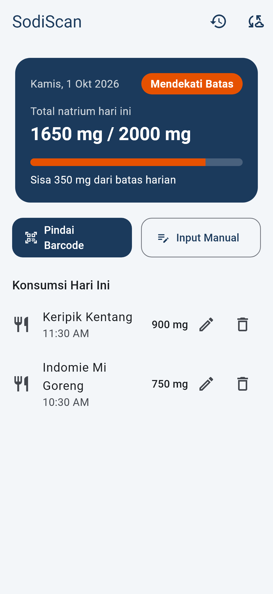
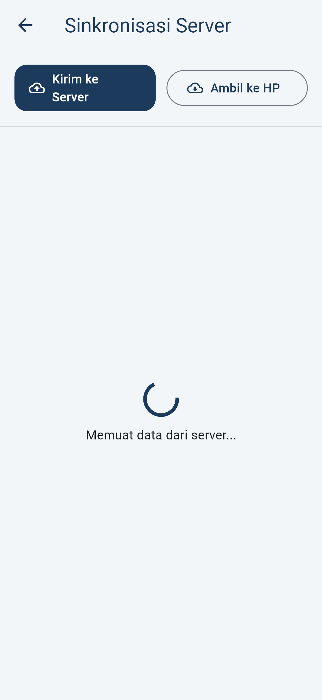
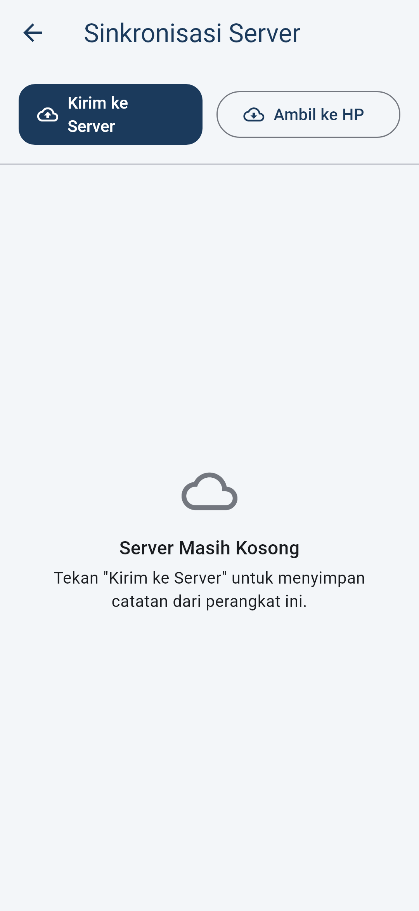
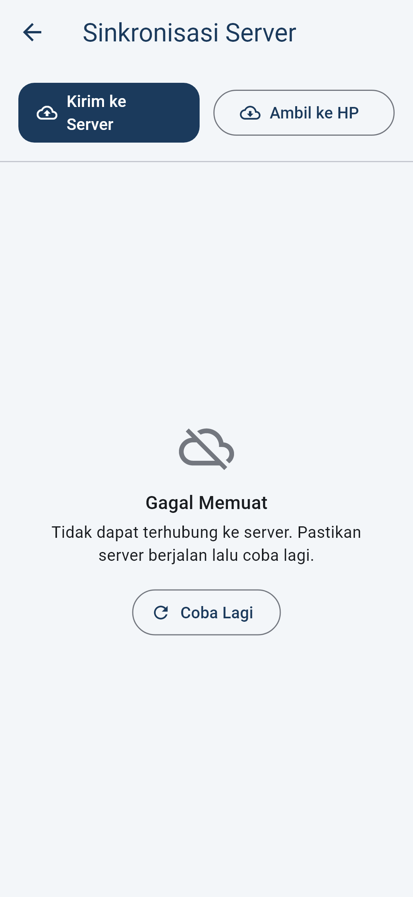
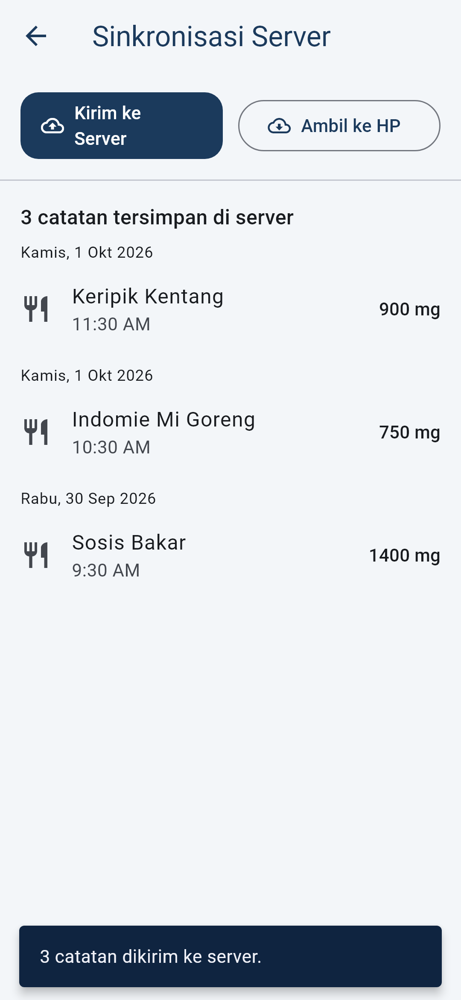
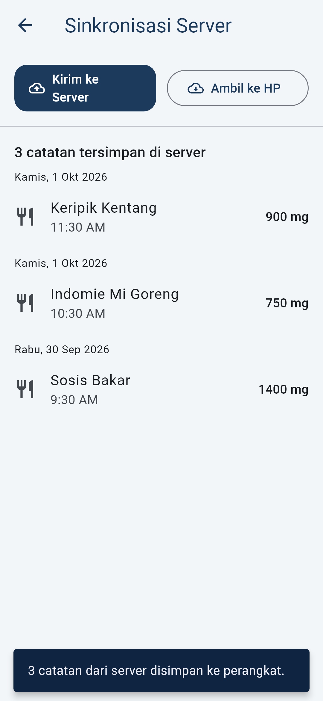

# Pertemuan 6 — Integrasi API dan Vertical Slice

Fitur inti yang dipilih: **Riwayat Konsumsi Natrium**.
Catatan konsumsi yang tersimpan lokal (Hive, Pertemuan 5) sekarang dapat **disimpan ke backend** dan **dimuat dari backend** melalui REST API. UI terhubung ke API lewat repository dan model.

SodiScan memakai dua API:

| API | Fungsi | Arah |
|---|---|---|
| **SodiScan API** (backend sendiri, folder [server/](../server)) | Menyimpan & memuat riwayat konsumsi | Simpan + Muat |
| Open Food Facts (sejak Pertemuan 4) | Data nutrisi produk berdasarkan barcode | Muat |

## Ringkasan untuk Reviewer

### 1. Apakah sudah ada koneksi ke API?

Ya. Alur vertical slice dari UI sampai backend:

```text
ServerSyncScreen (UI: loading / empty / error+retry / success)
  └─ ServerSyncNotifier                          lib/presentation/providers/server_sync_notifier.dart
       └─ Use case: GetServerConsumptions,       lib/domain/usecases/sync_consumptions.dart
          UploadConsumptions, RestoreConsumptions
            └─ ConsumptionSyncRepository (abstract)   lib/domain/repositories/consumption_sync_repository.dart
                 └─ ConsumptionSyncRepositoryImpl     lib/data/repositories/consumption_sync_repository_impl.dart
                      └─ ConsumptionRemoteDataSource  lib/data/datasources/remote/consumption_remote_data_source.dart
                           └─ HTTP (package:http) ──► SodiScan API  server/lib/api.dart
                                                        └─ server/data/consumptions.json
```

| Bagian | Lokasi |
|---|---|
| Model JSON (`fromJson` dengan validasi, `toJson`) | [food_consumption_model.dart](../lib/data/models/food_consumption_model.dart) |
| HTTP client: `GET /api/consumptions`, `PUT /api/consumptions/{id}` | [consumption_remote_data_source.dart](../lib/data/datasources/remote/consumption_remote_data_source.dart) |
| Error mapping: HTTP gagal/offline/timeout → `NetworkFailure`, JSON rusak → `DataFormatFailure` | [consumption_sync_repository_impl.dart](../lib/data/repositories/consumption_sync_repository_impl.dart) |
| Base URL API | [api_config.dart](../lib/core/config/api_config.dart) |
| Layar & state | [server_sync_screen.dart](../lib/presentation/screens/server_sync/server_sync_screen.dart), [server_sync_notifier.dart](../lib/presentation/providers/server_sync_notifier.dart) |
| Backend REST | [server/lib/api.dart](../server/lib/api.dart), [server/lib/consumption_store.dart](../server/lib/consumption_store.dart) |

### 2. Apakah sudah ada unit test?

Ya. 6 unit test wajib ada di [test/data/consumption_api_test.dart](../test/data/consumption_api_test.dart):

| No | Kasus wajib | Nama test | Yang diperiksa |
|---|---|---|---|
| 1 | Model valid | `1. Model valid` | JSON lengkap → model → entity, `toJson` kembali sama |
| 2 | Model invalid | `2. Model invalid` | null, bukan objek, id hilang, nama kosong, sodium negatif/teks, source salah, tanggal salah → `FormatException` |
| 3 | API sukses | `3. API sukses` | GET memuat daftar; PUT mengirim JSON ke `/api/consumptions/{id}` |
| 4 | Data kosong | `4. Data kosong` | `{"data": []}` → daftar kosong |
| 5 | HTTP gagal | `5. HTTP gagal` | status 500, offline, timeout → `NetworkFailure` |
| 6 | JSON rusak | `6. JSON rusak` | body terpotong, HTML, tanpa `data`, item tidak valid → `DataFormatFailure` |

Test pendukung:
- [sync_consumptions_test.dart](../test/domain/sync_consumptions_test.dart): use case kirim/muat/restore.
- [server_sync_screen_test.dart](../test/presentation/screens/server_sync/server_sync_screen_test.dart): widget test setiap state UI.
- [server/test/api_test.dart](../server/test/api_test.dart): test backend.

Output: [test-output.txt](screenshots/pertemuan6/test-output.txt)

```bash
flutter test test/data/consumption_api_test.dart
```

## Endpoint SodiScan API

| Method | Path | Fungsi | Respons |
|---|---|---|---|
| GET | `/api/health` | Cek server hidup | `{"status":"ok"}` |
| GET | `/api/consumptions` | Muat semua riwayat | `{"data":[...]}` |
| PUT | `/api/consumptions/{id}` | Simpan / perbarui satu catatan (idempotent, tidak membuat duplikat) | `200`, `400` JSON rusak, `422` data tidak valid |
| DELETE | `/api/consumptions/{id}` | Hapus satu catatan | `204` / `404` |

Contoh body:

```json
{
  "id": "1759289400000000",
  "barcode": "089686010947",
  "productName": "Indomie Mi Goreng",
  "sodiumMg": 750,
  "source": "scan",
  "consumedAt": "2026-10-01T10:30:00.000"
}
```

## State UI

| State | Kapan muncul | Screenshot |
|---|---|---|
| Entry | Ikon awan di AppBar Beranda |  |
| Loading | Saat memuat data dari server |  |
| Empty | Server belum punya data |  |
| Error + Retry | Server mati / offline / JSON rusak, tombol **Coba Lagi** |  |
| Success (simpan ke backend) | **Kirim ke Server** → data lokal di-PUT lalu daftar dimuat ulang |  |
| Success (muat dari backend) | **Ambil ke HP** → data server disimpan ke Hive, Beranda ikut diperbarui |  |

Selama sinkronisasi berjalan, kedua tombol dinonaktifkan dan muncul progress bar, sehingga tidak bisa double tap.

Screenshot dibuat dengan `flutter test --update-goldens test_screenshots/capture_p6_api_test.dart`.

## Cara Menjalankan (Demo)

1. Jalankan backend (terminal 1):

   ```bash
   cd server
   dart pub get
   dart run bin/server.dart
   ```

   Server berjalan di `http://localhost:8080`, data tersimpan di `server/data/consumptions.json`.

2. Jalankan aplikasi (terminal 2):

   ```bash
   flutter run
   ```

   Base URL otomatis: emulator Android → `http://10.0.2.2:8080`, Chrome/Windows → `http://localhost:8080`.
   Untuk HP fisik (satu Wi-Fi dengan laptop), isi IP laptop:

   ```bash
   flutter run --dart-define=API_BASE_URL=http://192.168.1.10:8080
   ```

3. Di aplikasi: catat konsumsi → ikon awan → **Kirim ke Server** → data tampil dari server.
4. Matikan server → tekan **Coba Lagi** → state error. Nyalakan lagi → **Coba Lagi** → data muncul.
5. Hapus data di HP → **Ambil ke HP** → data kembali di Beranda.
