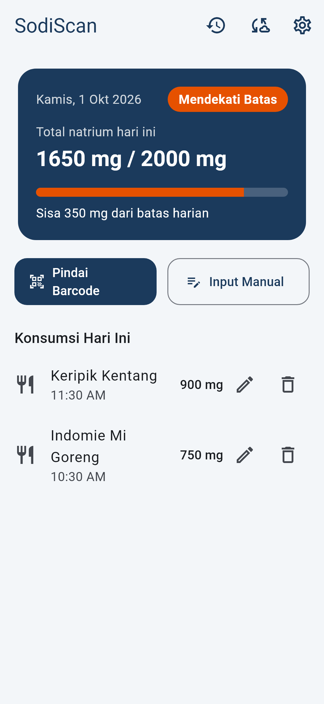
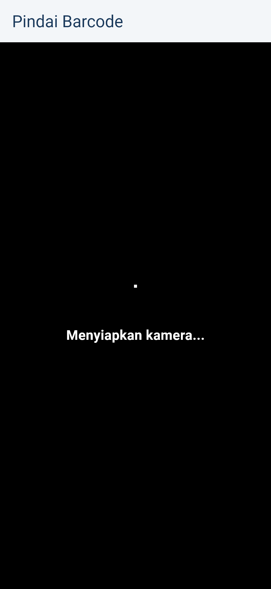
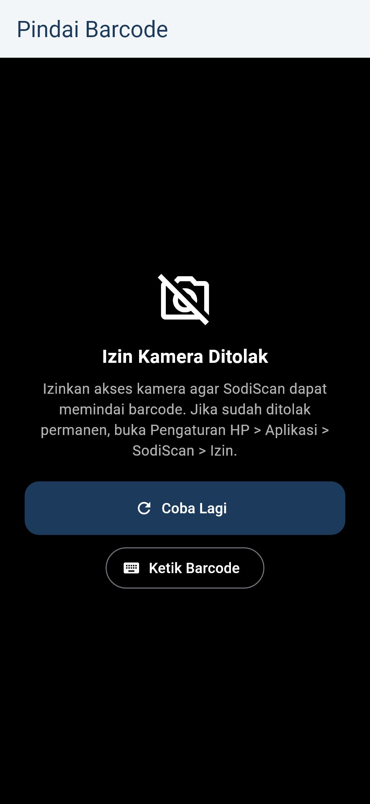
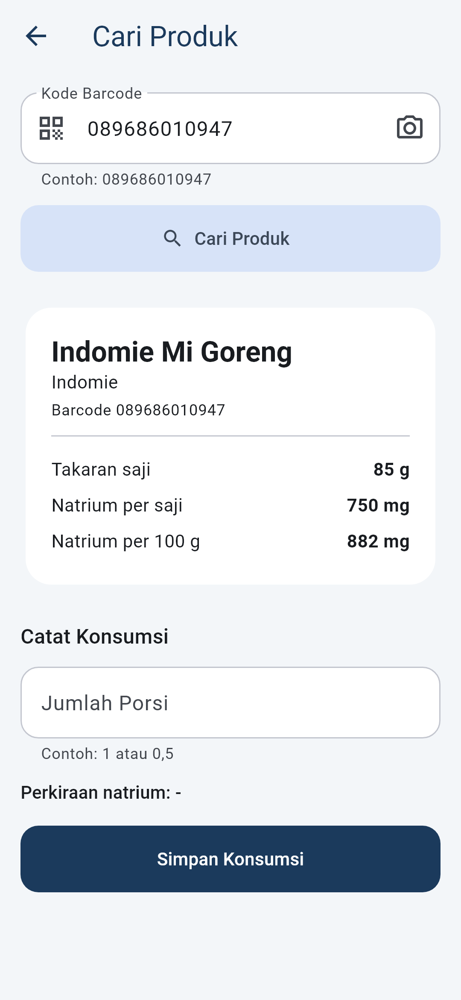
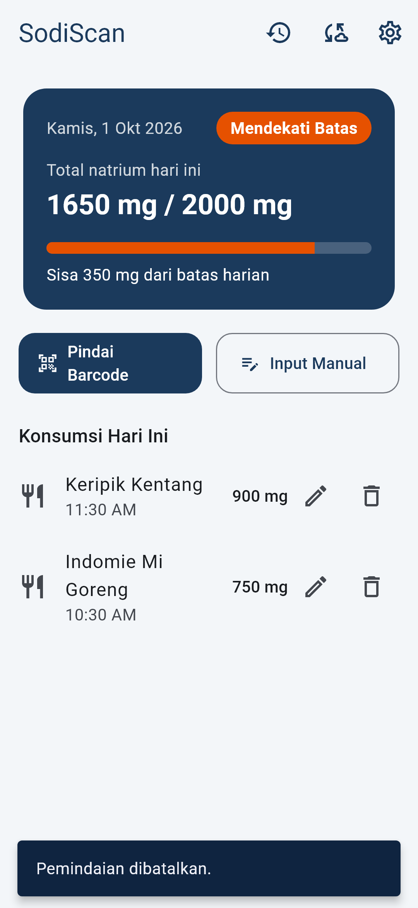
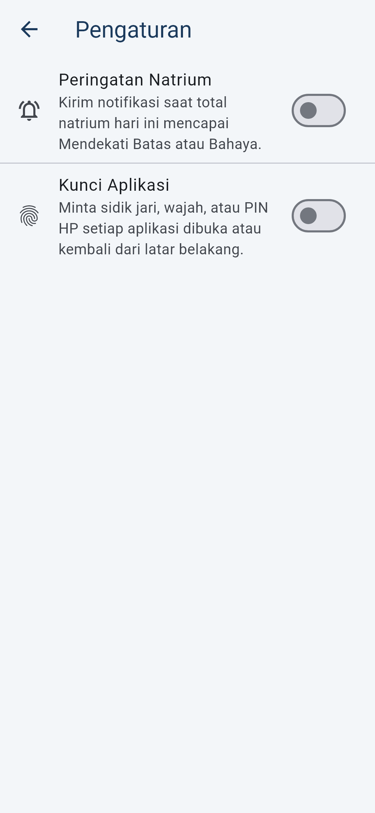
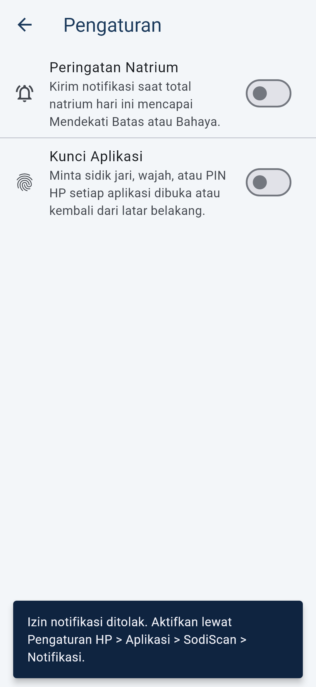
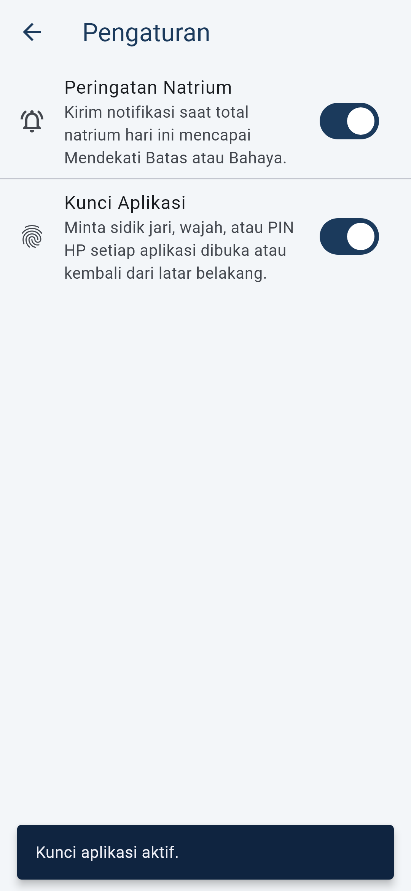
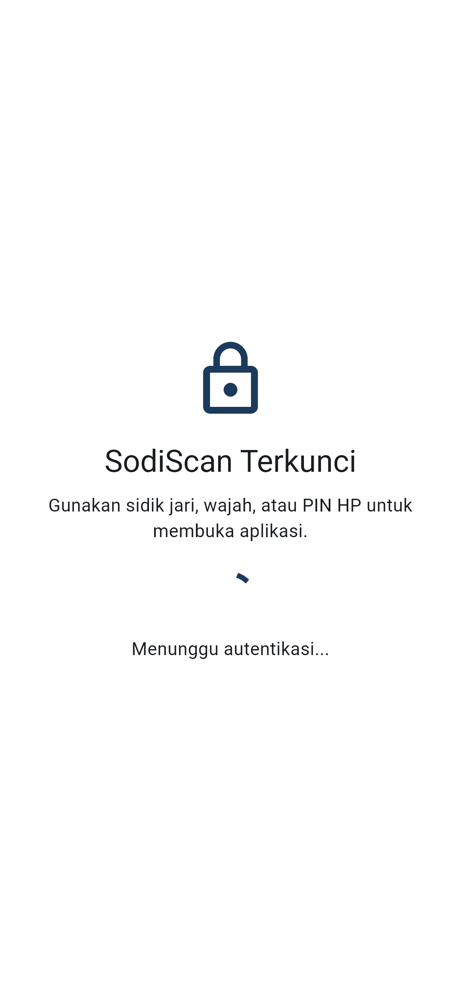
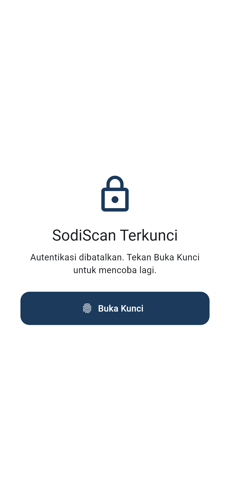

# Pertemuan 7 — MVP Lengkap + 3 Advanced Feature

Seluruh alur utama SodiScan sekarang dapat didemonstrasikan dari awal sampai akhir:

```text
[Kunci Aplikasi] → Beranda → Pindai Barcode (kamera) → Cari Produk (Open Food Facts) → isi porsi → simpan (Hive)
                         └→ Input Manual (form + validasi) ─────────────────────────────┘
Beranda: total harian + status risiko → Notifikasi saat Mendekati Batas / Bahaya
Beranda → Riwayat · Edit/Hapus · Sinkronisasi Server · Pengaturan
```

## Fitur Inti MVP

| Kebutuhan | Implementasi |
|---|---|
| Navigasi | Beranda → Pindai Barcode, Input Manual, Riwayat, Sinkronisasi Server, Pengaturan; hasil scan → Cari Produk → kembali ke Beranda |
| Form | Input Manual, Edit Konsumsi, Kode Barcode, Porsi/Berat |
| Validasi | Nama wajib, sodium 1–10000 mg, barcode 8–13 digit angka, porsi > 0; hasil scan kamera juga divalidasi |
| Penyimpanan data | Hive: catatan konsumsi (P5) dan pengaturan (P7); backend REST untuk sinkronisasi (P6) |

## 3 Advanced Feature

### 1. Kamera — Pindai Barcode

**Manfaat:** pengguna cukup mengarahkan kamera ke kemasan di rak toko. Tidak perlu mengetik 13 digit barcode atau membaca label nutrisi yang kecil.

| Bagian | Lokasi |
|---|---|
| Layar kamera (`mobile_scanner`, EAN-13/EAN-8/UPC) | [scanner_screen.dart](../lib/presentation/screens/scanner/scanner_screen.dart) |
| Dibuka dari tombol **Pindai Barcode** di Beranda | [home_screen.dart](../lib/presentation/screens/home/home_screen.dart) (`_openProductLookup`) |
| Ikon kamera di field barcode Cari Produk | [barcode_search_form.dart](../lib/presentation/screens/product_lookup/barcode_search_form.dart) |
| Barcode hasil scan langsung dicari | `ProductLookupScreen.route(initialBarcode:)` |

| Kondisi | Penanganan |
|---|---|
| Loading | "Menyiapkan kamera..." |
| Izin kamera ditolak | Pesan + cara mengizinkan di Pengaturan HP, tombol **Coba Lagi** dan **Ketik Barcode** |
| Kamera tidak didukung / gagal | Pesan + **Ketik Barcode** (dan **Coba Lagi** jika bisa dicoba ulang) |
| Pembatalan (tombol kembali) | Kembali ke Beranda dengan pesan "Pemindaian dibatalkan." |
| Barcode tidak valid terbaca | Diabaikan, kamera terus memindai |
| Gelap | Tombol senter di AppBar |

### 2. Notifikasi — Peringatan Natrium

**Manfaat:** pengguna langsung tahu saat konsumsi hari ini mulai berisiko, walaupun tidak sedang melihat Beranda. Notifikasi hanya muncul saat status **naik** (Aman → Mendekati Batas, atau → Bahaya), jadi tidak mengganggu.

| Bagian | Lokasi |
|---|---|
| Aturan kapan notifikasi dikirim + isi pesan | [send_sodium_alert.dart](../lib/domain/usecases/send_sodium_alert.dart) |
| Dipicu setelah total harian dihitung ulang | [add_consumption_notifier.dart](../lib/presentation/providers/add_consumption_notifier.dart) (`_alertIfNeeded`) |
| Implementasi `flutter_local_notifications` + izin Android 13 | [local_notification_service.dart](../lib/data/services/local_notification_service.dart) |
| Switch **Peringatan Natrium** | [settings_screen.dart](../lib/presentation/screens/settings/settings_screen.dart) |

| Kondisi | Penanganan |
|---|---|
| Izin diberikan | Switch menyala, "Peringatan natrium aktif." |
| Izin ditolak | Switch tetap mati + arahan ke Pengaturan HP > Aplikasi > SodiScan > Notifikasi |
| Status tetap / turun / beda hari / baru membuka aplikasi | Tidak ada notifikasi |
| Gagal menampilkan notifikasi | Diabaikan; pencatatan konsumsi tetap berhasil |

### 3. Autentikasi — Kunci Aplikasi (Sidik Jari / Wajah / PIN HP)

**Manfaat:** catatan konsumsi adalah data kesehatan pribadi. Kunci aplikasi mencegah orang lain yang meminjam HP melihatnya, tanpa perlu membuat akun. Konsep local-first di README tetap dipertahankan.

| Bagian | Lokasi |
|---|---|
| Kontrak autentikasi | [device_authenticator.dart](../lib/domain/services/device_authenticator.dart) |
| Implementasi `local_auth` + pemetaan error | [local_auth_device_authenticator.dart](../lib/data/services/local_auth_device_authenticator.dart) |
| State kunci (terkunci saat dibuka, terkunci lagi setelah > 30 detik di latar belakang) | [app_lock_notifier.dart](../lib/presentation/providers/app_lock_notifier.dart) |
| Layar kunci yang menutupi seluruh aplikasi | [app_lock_gate.dart](../lib/presentation/screens/lock/app_lock_gate.dart) |
| Switch **Kunci Aplikasi** (wajib autentikasi untuk menyalakan/mematikan) | [settings_notifier.dart](../lib/presentation/providers/settings_notifier.dart) |

| Kondisi | Penanganan |
|---|---|
| Menunggu autentikasi | Layar kunci + loading, isi aplikasi tidak terlihat |
| Dibatalkan pengguna | Tetap terkunci, pesan + tombol **Buka Kunci** |
| Terlalu banyak percobaan | Tetap terkunci, pesan untuk menunggu |
| HP tidak punya PIN/sidik jari | Saat mengaktifkan: ditolak dengan arahan. Saat membuka: kunci dimatikan otomatis agar pengguna tidak terkunci permanen |

Pengaturan disimpan di Hive box `settings` ([settings_repository_impl.dart](../lib/data/repositories/settings_repository_impl.dart)).

## Konfigurasi Platform

| File | Perubahan |
|---|---|
| [AndroidManifest.xml](../android/app/src/main/AndroidManifest.xml) | Izin `CAMERA`, `POST_NOTIFICATIONS`, `USE_BIOMETRIC` |
| [MainActivity.kt](../android/app/src/main/kotlin/com/sodiscan/sodiscan/MainActivity.kt) | `FlutterFragmentActivity` (wajib untuk `local_auth`) |
| [styles.xml](../android/app/src/main/res/values/styles.xml) | `LaunchTheme` memakai `Theme.AppCompat` (wajib untuk `local_auth`) |
| [build.gradle.kts](../android/app/build.gradle.kts) | Core library desugaring (wajib untuk `flutter_local_notifications`) + `appcompat` |
| [Info.plist](../ios/Runner/Info.plist), [AppDelegate.swift](../ios/Runner/AppDelegate.swift) | Deskripsi izin kamera & Face ID, delegate notifikasi |

## Bukti

| Screenshot | |
|---|---|
| Beranda (ikon Riwayat, Server, Pengaturan) |  |
| Kamera — menyiapkan |  |
| Kamera — izin ditolak |  |
| Hasil scan langsung dicari |  |
| Scan dibatalkan |  |
| Pengaturan |  |
| Izin notifikasi ditolak |  |
| Notifikasi & kunci aktif |  |
| Layar kunci — menunggu autentikasi |  |
| Layar kunci — dibatalkan |  |

Screenshot dibuat dengan `flutter test --update-goldens test_screenshots/capture_p7_advanced_test.dart`. Preview kamera asli, dialog izin sistem, notifikasi, dan dialog sidik jari hanya bisa direkam dari HP (lihat demo di bawah).

Test: [test-output.txt](screenshots/pertemuan7/test-output.txt)

| Test | Isi |
|---|---|
| [send_sodium_alert_test.dart](../test/domain/send_sodium_alert_test.dart) | Kapan notifikasi dikirim/tidak, isi pesan |
| [app_lock_notifier_test.dart](../test/presentation/providers/app_lock_notifier_test.dart) | Sukses, batal, lockout, HP tanpa kunci, terkunci lagi dari latar belakang |
| [settings_notifier_test.dart](../test/presentation/providers/settings_notifier_test.dart) | Izin notifikasi diberi/ditolak, aktifkan kunci sukses/batal |
| [scanner_status_view_test.dart](../test/presentation/screens/scanner/scanner_status_view_test.dart) | Loading, izin ditolak, tidak didukung, error |
| [home_screen_test.dart](../test/presentation/screens/home/home_screen_test.dart) | Scan berhasil → produk dicari, scan dibatalkan, Ketik Barcode |
| [app_lock_gate_test.dart](../test/presentation/screens/lock/app_lock_gate_test.dart), [settings_screen_test.dart](../test/presentation/screens/settings/settings_screen_test.dart) | Widget test layar kunci & pengaturan |

## Demo di HP Android

1. `flutter run` ke HP (USB debugging aktif).
2. **Kamera:** Beranda → **Pindai Barcode** → izinkan kamera → arahkan ke barcode Indomie → produk tampil → isi porsi → simpan. Ulangi lalu tolak izin untuk menunjukkan pesan izin ditolak; tekan kembali untuk menunjukkan pembatalan.
3. **Notifikasi:** Pengaturan → nyalakan **Peringatan Natrium** → izinkan → catat makanan sampai total > 1500 mg, lalu > 2000 mg → notifikasi muncul.
4. **Autentikasi:** Pengaturan → nyalakan **Kunci Aplikasi** → sidik jari/PIN → tutup aplikasi → buka lagi → layar kunci. Tekan batal pada dialog → pesan dibatalkan → **Buka Kunci**.
