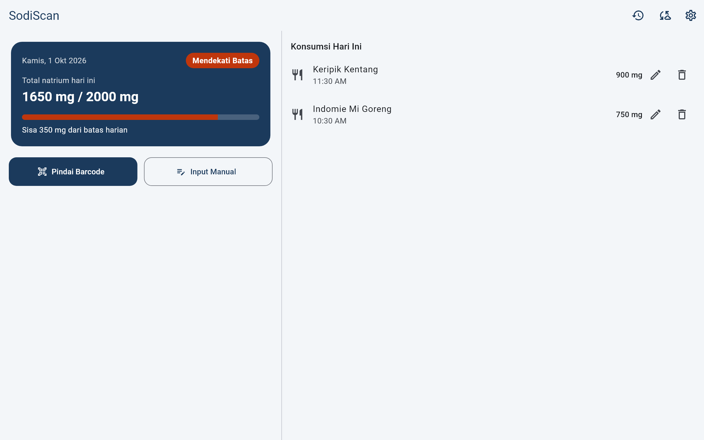
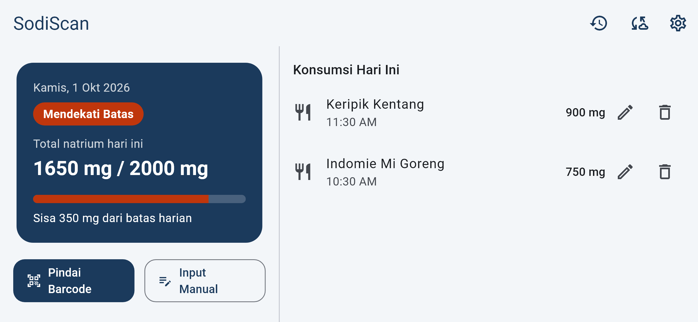
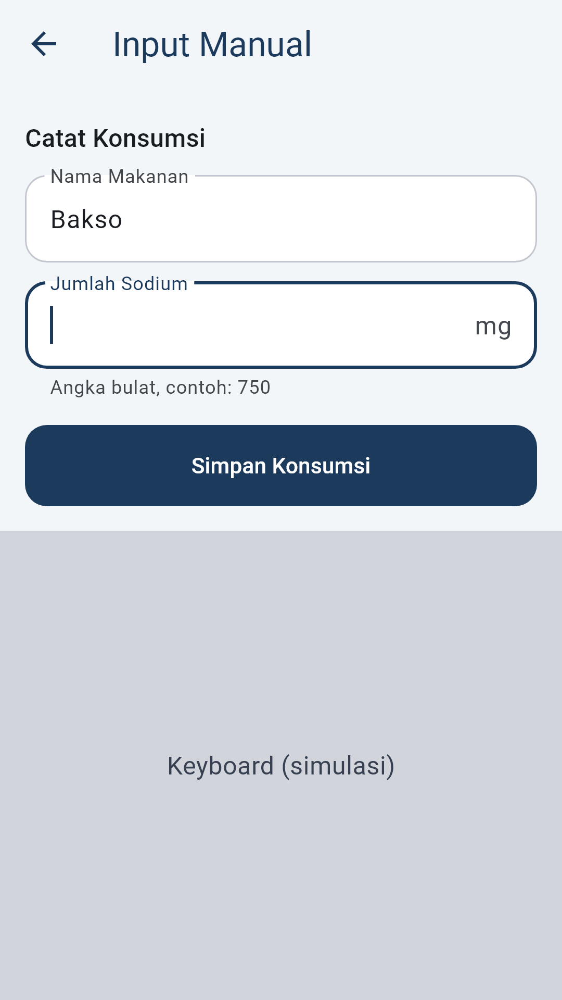
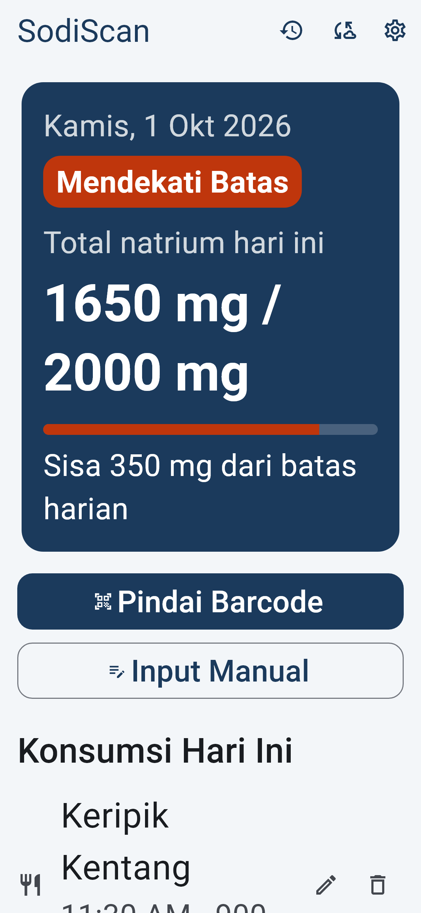
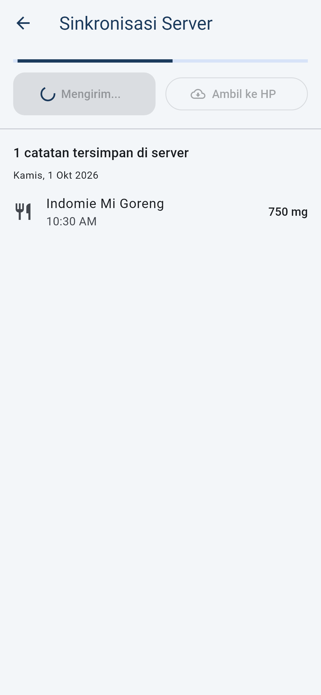
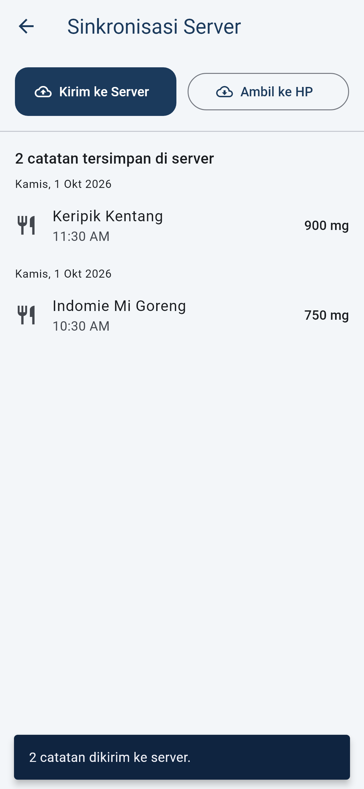

# Pertemuan 8 — Layout Adaptif, Keyboard-safe, Aksesibilitas, Feedback Aksi

Empat hal yang dikerjakan di atas MVP Pertemuan 7. Semua bisa dicek reviewer saat aplikasi di-RUN.

## 01 — Layout Adaptif (Layar Besar / Layar Kecil)

| Lebar layar | Tampilan |
|---|---|
| < 840 dp (HP portrait, tablet portrait) | Satu kolom. Di tablet lebar konten dibatasi 640 dp dan ditaruh di tengah agar form tidak melebar |
| ≥ 840 dp (HP landscape, tablet landscape) | **Beranda:** ringkasan + tombol di kiri, daftar konsumsi di kanan. **Cari Produk:** form barcode di kiri, hasil + form porsi di kanan. **Riwayat:** dua kartu per baris |

| Bagian | Lokasi |
|---|---|
| Breakpoint, `adaptivePadding`, `TwoPaneLayout` | [adaptive_layout.dart](../lib/presentation/widgets/adaptive_layout.dart) |
| Beranda dua kolom | [home_screen.dart](../lib/presentation/screens/home/home_screen.dart) (`_HomeContent`) |
| Cari Produk dua kolom | [product_lookup_screen.dart](../lib/presentation/screens/product_lookup/product_lookup_screen.dart) |
| Riwayat dua kartu per baris (urutan baca tetap dari tanggal terbaru) | [history_screen.dart](../lib/presentation/screens/history/history_screen.dart) (`_DayGrid`) |
| Input Manual, Pengaturan, Sinkronisasi: lebar dibatasi | `adaptivePadding(context)` |
| Layar kunci & bingkai kamera menyesuaikan landscape | [app_lock_gate.dart](../lib/presentation/screens/lock/app_lock_gate.dart), [scanner_screen.dart](../lib/presentation/screens/scanner/scanner_screen.dart) |

**Cara cek saat RUN:** buka Beranda → putar HP ke landscape (atau jalankan di emulator tablet).

## 02 — Keyboard-safe UI

| Perilaku | Implementasi |
|---|---|
| Field aktif **dan tombol Simpan** tetap terlihat di atas keyboard | `scrollPadding` 160 px di bawah field ([keyboard_safe.dart](../lib/presentation/widgets/keyboard_safe.dart)) |
| Tombol keyboard **Next** pindah ke field berikutnya, **Done** langsung menyimpan | `textInputAction` + `onFieldSubmitted` di Input Manual, Porsi, Barcode (Search) |
| Validasi gagal → field pertama yang salah difokuskan dan discroll ke layar | `_focusFirstInvalidField()` di [consumption_form.dart](../lib/presentation/screens/add_consumption/consumption_form.dart), `requestFocus()` di form barcode & porsi |
| Tap di luar field menutup keyboard | `onTapOutside: dismissKeyboard` |
| Geser daftar menutup keyboard | `keyboardDismissBehavior: onDrag` |

**Cara cek saat RUN:** Input Manual → isi nama → tekan Next → isi sodium → keyboard terbuka tapi tombol **Simpan Konsumsi** tetap terlihat → tekan Done → tersimpan.

## 03 — Aksesibilitas Dasar

| Masalah di MVP | Perbaikan |
|---|---|
| Kartu ringkasan dibaca pembaca layar sepotong-sepotong | Satu kalimat: *"Ringkasan Kamis, 1 Okt 2026. Total natrium 1650 mg dari batas 2000 mg. Status Mendekati Batas. Sisa 350 mg dari batas harian."* |
| Tombol ikon Ubah/Hapus tidak menyebut item | Label menjadi "Ubah Indomie Mi Goreng" / "Hapus Indomie Mi Goreng" |
| Item konsumsi dibaca terpisah (nama, jam, sodium) | Satu label: "Indomie Mi Goreng, 750 mg, pukul 10.30" |
| Badge "Mendekati Batas" (oranye `#E65100`) kontras 3,4:1 dengan teks putih | Diganti `#BF360C`, kontras 5,6:1 (lolos WCAG AA) |
| Teks diperbesar 200% → **overflow** (tanggal + badge, tombol aksi) | Tanggal & badge memakai `Wrap`; tombol Pindai/Input Manual dan Kirim/Ambil disusun vertikal; sodium pindah ke subtitle |
| Judul bagian tidak dikenali sebagai heading | `Semantics(header: true)` pada judul bagian, tanggal Riwayat, judul layar kunci & state |
| Pesan error / loading / hasil tidak diumumkan | `liveRegion` pada pesan error form, state kosong/error, loading pencarian, perkiraan natrium, pesan layar kunci |
| Progress bar tanpa label | `semanticsLabel` pada progress sinkronisasi dan pengaturan |
| Tombol senter tidak menunjukkan status | Tooltip "Nyalakan / Matikan senter", ikon berubah, nonaktif jika tidak tersedia |

Diuji otomatis dengan guideline bawaan Flutter: `androidTapTargetGuideline` (≥ 48 dp), `iOSTapTargetGuideline`, `labeledTapTargetGuideline`, `textContrastGuideline` — lolos di Beranda dan Input Manual.

**Cara cek saat RUN:** Pengaturan HP → Ukuran font paling besar, atau aktifkan TalkBack lalu sentuh kartu ringkasan.

## 04 — Feedback Aksi

Setiap aksi sekarang memberi tanda *sedang diproses* dan *hasilnya*:

| Aksi | Selama proses | Setelah selesai |
|---|---|---|
| Simpan konsumsi (manual / produk) | Tombol "Menyimpan..." + spinner, field dinonaktifkan | Getar ringan + SnackBar "Konsumsi berhasil disimpan." |
| Cari Produk | **Baru:** tombol jadi "Mencari..." + spinner, plus "Mencari produk..." di area hasil | Data produk / pesan tidak ditemukan / error + Coba Lagi |
| Kirim ke Server / Ambil ke HP | **Baru:** tombol yang ditekan jadi "Mengirim..." / "Mengambil...", tombol lain nonaktif, progress bar | SnackBar jumlah catatan |
| Hapus | Dialog konfirmasi | SnackBar "Konsumsi dihapus." |
| Pindai barcode | Bingkai + petunjuk | **Baru:** getar saat barcode terbaca, langsung mencari produk |
| Senter | **Baru:** ikon & tooltip menunjukkan nyala/mati | |
| Ubah pengaturan | Progress bar + switch nonaktif | SnackBar hasil / arahan izin |
| Validasi gagal | Pesan di bawah field + field difokuskan | |

| Bagian | Lokasi |
|---|---|
| Status aksi sinkronisasi (`SyncAction`) | [server_sync_state.dart](../lib/presentation/providers/server_sync_state.dart), [server_sync_notifier.dart](../lib/presentation/providers/server_sync_notifier.dart) |
| Tombol sinkronisasi | [server_sync_screen.dart](../lib/presentation/screens/server_sync/server_sync_screen.dart) |
| Tombol Cari Produk | [barcode_search_form.dart](../lib/presentation/screens/product_lookup/barcode_search_form.dart) |
| Getar & tombol senter | [scanner_screen.dart](../lib/presentation/screens/scanner/scanner_screen.dart) (`TorchButton`) |

## Bukti

| Screenshot | |
|---|---|
| 01 Layout adaptif — tablet landscape (dua kolom) |  |
| 01b Layout adaptif — HP landscape |  |
| 02 Keyboard-safe — field dan tombol Simpan di atas keyboard |  |
| 03 Aksesibilitas — teks 200%, tanpa overflow, tombol tersusun vertikal |  |
| 04 Feedback — tombol "Mengirim..." saat proses |  |
| 04b Feedback — pesan hasil |  |

Screenshot dibuat dengan `flutter test --update-goldens test_screenshots/capture_p8_ux_test.dart`. Keyboard pada screenshot 02 adalah blok abu-abu simulasi (tinggi 300 dp) karena widget test tidak menggambar keyboard sistem; perilaku resize & scroll-nya asli.

Test: [test-output.txt](screenshots/pertemuan8/test-output.txt)

| Test | Isi |
|---|---|
| [adaptive_layout_test.dart](../test/presentation/ux/adaptive_layout_test.dart) | Satu kolom di HP, dua kolom di landscape, lebar dibatasi di tablet, Riwayat 2 kartu/baris, Cari Produk dua kolom |
| [keyboard_safe_test.dart](../test/presentation/ux/keyboard_safe_test.dart) | Tombol Simpan terlihat di atas keyboard (HP 360×640), Next/Done, fokus ke field salah, tap di luar menutup keyboard |
| [accessibility_test.dart](../test/presentation/ux/accessibility_test.dart) | 4 guideline Flutter, label pembaca layar, heading, teks 200% tanpa overflow |
| [action_feedback_test.dart](../test/presentation/ux/action_feedback_test.dart) | "Mengirim..." / "Mengambil...", hapus + SnackBar, status tombol senter |

Total `flutter test`: 164 test lulus.
